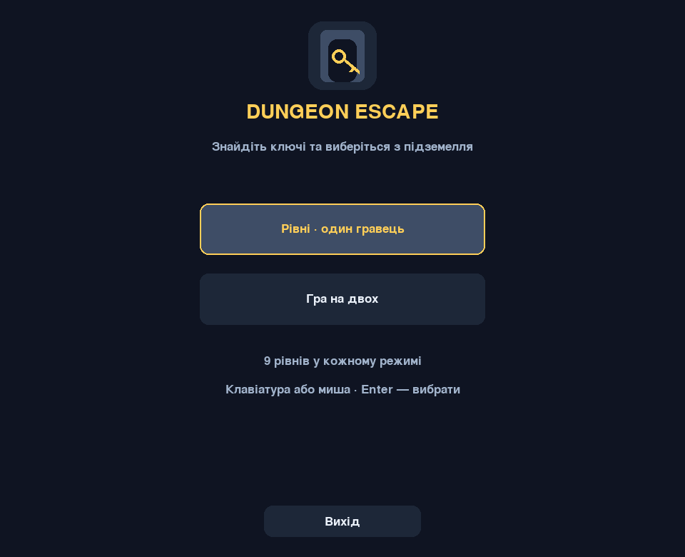

# Dungeon Escape

Навчальна 2D-гра на Python і Pygame для курсу «Розробка ігрових додатків».
Знайдіть ключі, відкрийте двері та виберіться з лабіринту.



## Режими

- **Рівні:** 9 лабіринтів для одного гравця.
- **Гра на двох:** 9 лабіринтів для двох гравців на одній клавіатурі.

Номери рівнів розташовані сіткою 3 × 3. Вибір — мишею або стрілками та Enter.
Спочатку відкрито лише перший рівень. Кожна перемога відкриває наступний;
прогрес одиночного режиму та гри на двох незалежний.

У грі на двох синій гравець керується стрілками, рожевий — WASD.
Обидва грають в одному лабіринті, у кожного власні ключі й вихід.
Спочатку потрібно одночасно стати на свої кольорові плити — це відкриває
спільні ворота. Далі гравці по черзі відкривають свої двері для обох:
без напарника обійти замкнений прохід не можна.
Перемога — коли вийшли обидва. Якщо охоронець упіймає одного, спробу потрібно
почати заново. Гравець, який уже вийшов, безпечно чекає напарника.

## Ключі та двері

- **Круглий ключ** відкриває одні двері свого кольору й витрачається.
- **Ключ-ромб** потрібен для завершення рівня через власний вихід.
- Чужі ключі не підбираються; чужі замкнені двері відкрити не можна.
- Червоні квадрати — охоронці, контакт із ними означає поразку.

На обов’язковому маршруті стоять охоронці; щоб розминутися з ними,
потрібно використовувати бічні укриття. Пастки періодично активуються:
червона — небезпечна, зелена — безпечна, жовта — скоро увімкнеться.
Стояти на пастці під час активації теж небезпечно.

Наступні рівні мають довший основний маршрут: від 54 до 86 кроків на гравця.
Кількість дверей, охоронців і пасток зростає, а інтервали їхнього руху
та перемикання зменшуються. Карти фіксовані:
повторний запуск не змінює лабіринт. Складність для людей ще потребує ігрових спроб.

## Час і топ

Таймер показує **години:хвилини:секунди** — `00:00:00`. Пауза зупиняє час.

У головному меню є «Топ рівнів», у виборі рівня — «Топ рівня» або клавіша T.
Для кожного рівня та режиму зберігаються 10 найкращих проходжень на цьому
комп’ютері. Сортування — за точним часом, потім за кількістю кроків.
Ім’я гравця або команди можна змінити в головному меню.
В топі стрілки перемикають рівні, Tab — режим; також доступні кнопки мишею.
Це локальна таблиця, без мережевого сервера.

## Запуск

Потрібен Python 3.10+; рекомендовано **Python 3.12**.

**Windows:** розпакуйте проєкт і відкрийте `run.bat`. Він створить середовище,
встановить Pygame й запустить гру. Для першого запуску потрібен інтернет.

Ручний запуск із кореня проєкту:

```bash
python -m venv .venv
```

Активація: `source .venv/bin/activate` у Linux / macOS,
`.venv\Scripts\Activate.ps1` у Windows PowerShell.

```bash
python -m pip install -r requirements.txt
python main.py
```

## Керування

| Клавіші | Дія |
| --- | --- |
| Стрілки / WASD | Рух в одиночній грі |
| Стрілки | Гравець 1 у грі на двох |
| WASD | Гравець 2 у грі на двох |
| P | Пауза / продовжити |
| R | Почати рівень заново для обох гравців |
| M | Вибір рівня |
| Enter після перемоги | Наступний рівень |
| Esc | Назад; у головному меню — вихід |

Вікно можна змінювати за розміром. Прогрес зберігається локально у
`.cache/dungeon_escape/progress.json`. Там само зберігаються топ та ім’я.
Карти й правила оновлено, тому нові кампанії починаються з першого рівня.
Старий прогрес збережено в полі `legacy_progress`; він не відкриває нові рівні.
Видалення файла скидає і проходження, і локальні результати.

## Файли

```text
main.py                      # Точка запуску
run.bat                      # Запуск у Windows
src/dungeon_escape/
    app.py                   # Меню, малювання, керування
    campaign.py              # Карти та правила двох режимів
    records.py               # Час і таблиці результатів
    model.py, levels.py      # Початкова модель прототипів
prototypes/                  # Старі точки запуску
tests/                      # Автоматичні перевірки
docs/                       # Концепція, алгоритми, результати
presentation/               # Матеріали частини 1
```

## Перевірка

```bash
python -m unittest discover -s tests -v
```

**53 тести пройдено.** Перевірено прохідність усіх 18 карт з очікуванням
і ухиленням, реальну можливість програти, спільні плити й двері, блокування
рівнів, топ, формат часу, керування, паузу й збереження прогресу.
Перевірка графіки виконана через SDL `dummy`, без фізичного дисплея.
