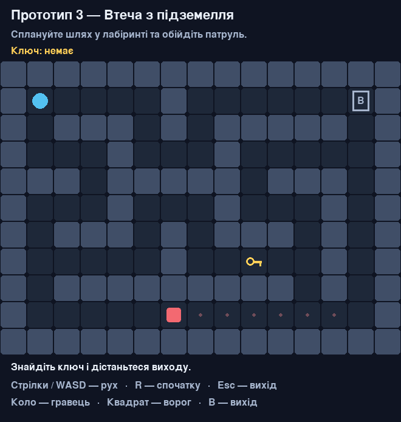

# Dungeon Escape

Навчальний проєкт із курсу «Розробка ігрових додатків». Частина 1.

2D-гра з видом зверху на Python і Pygame. Потрібно пройти лабіринт,
знайти ключ та дістатися виходу, уникаючи охоронця.



## Поточна версія

Підготовлено три прототипи: лабіринт із ключем, кімнату з патрулем
та рівень, який поєднує ці механіки. Працюють рух, зіткнення зі стінами,
підбирання ключа, перемога, поразка та перезапуск.

Для графіки використано прості фігури. Звук і спрайти поки не додані.

## Запуск

Потрібні Python 3.10+ та Pygame 2.6.1.

```bash
python -m venv .venv
```

Активація середовища:

```bash
# Linux / macOS
source .venv/bin/activate
```

```powershell
# Windows PowerShell
.venv\Scripts\Activate.ps1
```

Встановлення залежностей і запуск основного прототипу:

```bash
python -m pip install -r requirements.txt
python prototypes/03_dungeon_escape.py
```

Інші прототипи:

```bash
python prototypes/01_key_and_exit.py
python prototypes/02_enemy_patrol.py
```

## Керування

| Клавіші | Дія |
| --- | --- |
| Enter | Почати гру |
| Стрілки або WASD | Рух |
| R | Почати рівень заново |
| Esc | Закрити гру |

Синє коло — гравець, червоний квадрат — ворог, золотий символ — ключ,
«В» — вихід. Без ключа вихід не завершує рівень.

## Структура

```text
Dungeon-Escape/
├── docs/
│   ├── concept.md
│   ├── analogues.md
│   ├── diagrams.md
│   ├── pseudocode.md
│   ├── implementation-plan.md
│   └── validation.md
├── prototypes/
│   ├── 01_key_and_exit.py
│   ├── 02_enemy_patrol.py
│   ├── 03_dungeon_escape.py
│   └── README.md
├── src/dungeon_escape/
│   ├── __init__.py
│   ├── __main__.py
│   ├── model.py
│   ├── levels.py
│   └── app.py
├── tests/
│   ├── test_model.py
│   └── test_app.py
├── presentation/
│   ├── slides.md
│   └── images/
├── requirements.txt
└── README.md
```

У `docs` зібрано опис гри, порівняння з аналогами, схеми та план роботи.
`src` містить спільну логіку й інтерфейс, `prototypes` — окремі запуски рівнів,
`tests` — перевірки правил і подій Pygame.

## Перевірка

```bash
python -m unittest discover -s tests -v
```

Пройдено 24 тести. Перевірено рух, ключ і вихід, патруль, стани гри
та можливість пройти кожний рівень. Подробиці — у [звіті](docs/validation.md).
