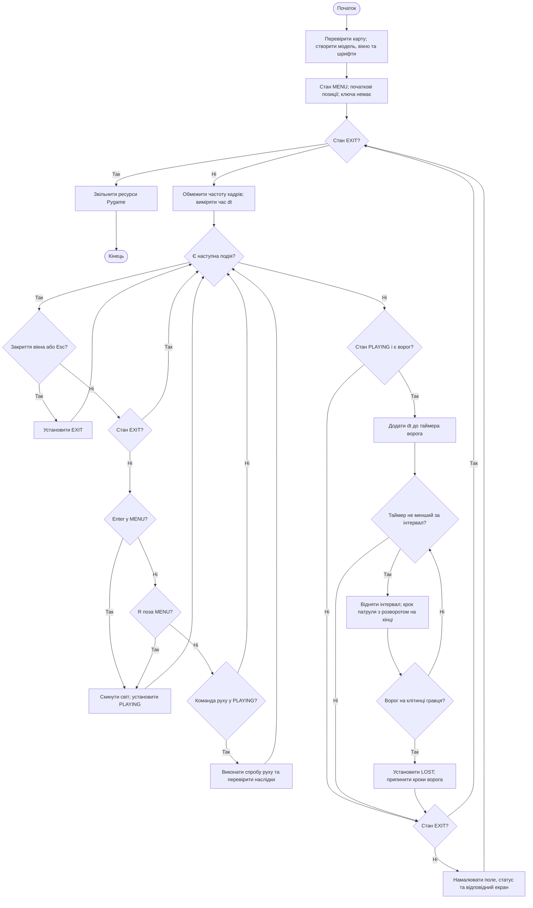
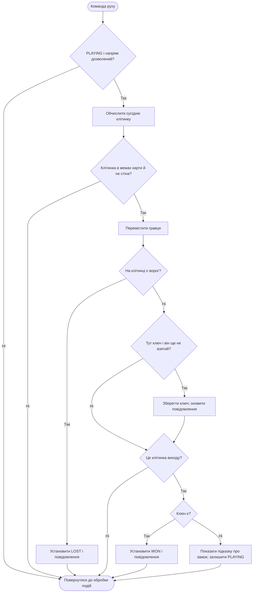
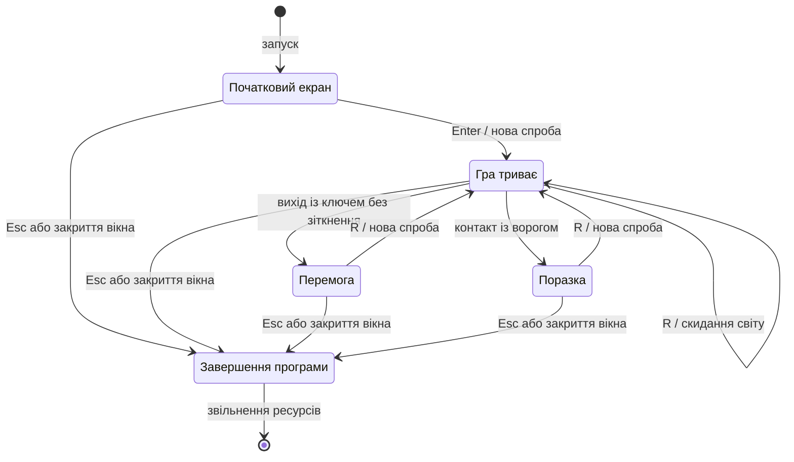

# Блок-схеми та стани гри

Головний цикл реалізовано в `Application.run`, обробку клавіш —
в `Application.handle_event`, правила руху — в `Game.move` та `Game.update`.

## Блок-схема основного алгоритму

`dt` — тривалість кадру в секундах.

## Блок-схема спроби руху

Зіткнення перевіряється перед ключем і виходом. Після переходу в `WON`
або `LOST` рух гравця та ворога зупиняється.

## Діаграма станів

| Стан | Оновлення світу | Допустимі основні команди |
| --- | --- | --- |
| MENU | Немає | Enter, Esc, закриття вікна |
| PLAYING | Рух за подіями, патруль за таймером | Рух, R, Esc, закриття вікна |
| WON | Немає | R, Esc, закриття вікна |
| LOST | Немає | R, Esc, закриття вікна |
| EXIT | Немає, цикл завершується | Нові ігрові команди ігноруються |

Ключ — змінна всередині світу, а не окремий стан гри. Окремого стану паузи
та повернення до початкового екрана під час спроби немає. У прототипі 1
перехід до `LOST` недосяжний, бо відсутній ворог.
