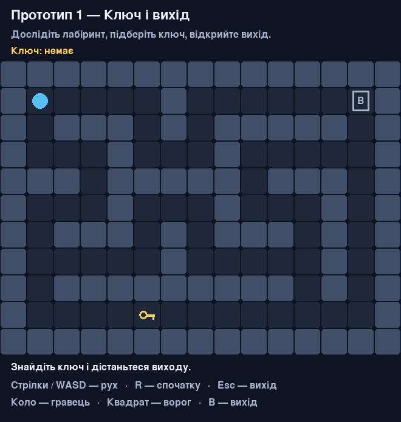
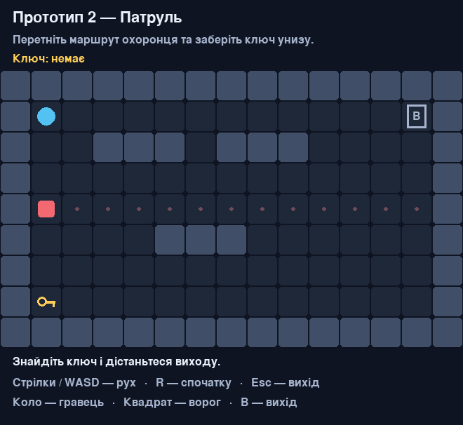

# Dungeon Escape

Розробка ігрових додатків · Частина 1

Python · Pygame · 2D-гра з видом зверху

---

# Ідея гри

Знайти ключ у лабіринті та дістатися виходу, уникаючи охоронця.

- Рух у чотирьох напрямках.
- Стіни обмежують маршрут.
- Ключ дозволяє завершити рівень.
- Контакт із ворогом — поразка.

---

# Аналоги

| Гра | Спільна механіка |
| --- | --- |
| Pac-Man | Лабіринт та уникнення ворогів |
| Chip’s Challenge | Клітинкова карта, ключі та вихід |

У Dungeon Escape залишено один ключ і один патруль.

---

# Алгоритм

Обробка клавіш → рух гравця → перевірка зіткнення, ключа й виходу →
оновлення патруля → малювання.

Стани: початковий екран, гра, перемога, поразка, завершення.

R відновлює рівень. Esc закриває програму.

---

# Прототип 1 — ключ і вихід

Рух і пошук ключа в лабіринті без ворога.

---

# Прототип 2 — патруль

Перехід через маршрут охоронця, зіткнення та повторна спроба.

---

# Прототип 3 — лабіринт із ворогом

Поєднання навігації, ключа й патруля на одному рівні.

---

# Результати та подальша робота

Готові три прототипи, схеми алгоритмів і псевдокод. Пройдено 24 тести,
зокрема перевірку шляху до перемоги в кожному рівні.

Далі: перевірка з гравцями, уточнення рівня, екран правил та спрайти.
