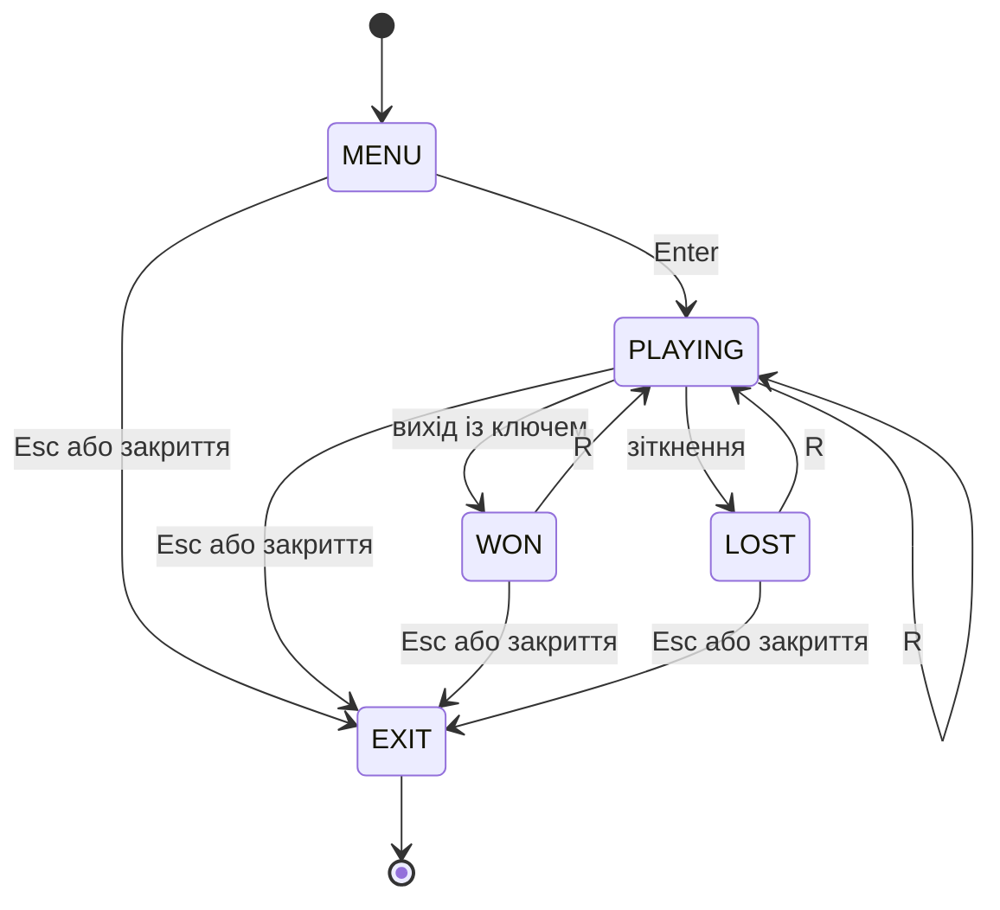

# Слайд 1. Dungeon Escape

**Частина 1 проєктної роботи**

Курс: «Розробка ігрових додатків»

Виконавець: один студент, роль — програміст.
Ім’я та група: заповнити перед захистом.

Python · Pygame · 2D · вид зверху

---

# Слайд 2. Ідея та мета

Гравець шукає ключ у підземеллі, уникає охоронця й відкриває вихід.

- Навчальна мета: спроєктувати правила, стани й ігровий цикл та перевірити їх кодом.
- Перемога: дійти до виходу з ключем без контакту з ворогом.
- Поразка: зайняти одну клітинку з охоронцем.
- Обсяг: три малі прототипи; завершення гри заплановано на частину 2.

---

# Слайд 3. Аналоги та власний обсяг

| Орієнтир | Корисна ідея | Рішення Dungeon Escape |
| --- | --- | --- |
| Pac-Man | Лабіринт і рухома небезпека | Компактна карта та один передбачуваний патруль |
| Chip’s Challenge | Клітинкові задачі з ключами та виходом | Одна залежність «ключ → вихід» |

Поточна гра не має рахунку, бою, багатьох типів замків чи кампанії.
Порівняння та джерела: [документ про аналоги](../docs/analogues.md).

---

# Слайд 4. Алгоритм і стани

Кадр: **події → рух гравця → патруль за таймером → малювання**.

Повна [блок-схема](../docs/diagrams.md) та [псевдокод](../docs/pseudocode.md).

---

# Слайд 5. Прототип 1 — ключ і вихід

Лабіринт без ворога ізолює навігацію та залежність «ключ → вихід».
Стіни блокують рух; без ключа вихід показує підказку.

---

# Слайд 6. Прототип 2 — патруль

Відкрита кімната допомагає спостерігати таймер, розворот патруля та контакт.
Зіткнення завершує спробу, R скидає всі змінні.

---

# Слайд 7. Прототип 3 — об’єднаний рівень

Поєднано лабіринт, перенесений ключ і патруль у нижньому коридорі.
Потрібно спланувати маршрут і безпечний прохід до виходу.
Графіка залишається прототипною; звук не реалізований.

---

# Слайд 8. Перевірка результату

- 24 автоматичні тести пройдено без пропусків.
- Підтверджено прохідність усіх трьох рівнів із дотриманням правил ворога.
- Перевірено події Pygame, перемогу, поразку, перезапуск і українські символи.
- Кожна точка запуску виконала 8 кадрів і штатно завершилася через QUIT.
- Знімки отримано з реального малювання Pygame через SDL `dummy`.

Ручна оцінка на фізичному дисплеї й тестування з гравцями ще не виконані.
Докладні результати: [звіт](../docs/validation.md).

---

# Слайд 9. Наступна частина

1. Зібрати спостереження за спробами гравців.
2. Уточнити один основний рівень і темп патруля.
3. Додати екран правил і завершити оформлення.
4. Перевірити запуск на цільовому комп’ютері та підготувати архів для передачі.

Вже отримано: опис концепції, алгоритми та три перевірені прототипи.
Наступна мета: завершена мінімальна навчальна гра.

План: [частина 2](../docs/implementation-plan.md).
